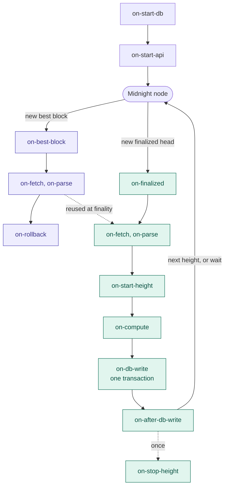

# UmbraDB


A Midnight Modular Indexer. UmbraDB reads blocks from Midnight, and stores what the modules compute in PostgreSQL
deterministically. Run what you need, extend what is missing.

## What UmbraDB is

- **Standalone.** It needs only a Midnight node: no other indexer, no other service.
- **Official ledger parsing.** Transactions are parsed and applied by the official `midnight-ledger` packages; UmbraDB
  never re-implements their formats.
- **Modules.** A feature is a module: its tables, its callbacks for each block, its API. Adding one leaves the core as
  it is, and UmbraDB's own core modules use the same API as yours.
- **Only what you configure.** A process runs the modules its configuration file names, and nothing else.
- **One block, one transaction.** Only finalized blocks are stored, so the database never rolls back. A crash leaves
  the last whole block, and a restart resumes there.
- **Deterministic.** The same chain gives the same database. Each table has a digest, updated every block, and two
  instances compare one contents hash.
- **Backup and restore.** A backup is a `pg_dump` file, checked against its contents hash when it is restored.
- **Private data apart.** Private modules run in private processes with their own databases; the public database stays
  shareable.
- **Server and browser.** The same code runs on Node.js with PostgreSQL 18 and in a browser page on PGlite.

## Requirements

- **Node.js 24** or later. The configuration file is TypeScript, loaded through Node.js's type stripping.
- **A Midnight node's WebSocket RPC** (`ws://` or `wss://`), such as the public preview node
  `wss://rpc.preview.midnight.network`.
- **A database (OPTIONAL):** PostgreSQL 18, or nothing extra with PGlite (bundled; development only, see
  [Choosing a database](docs/choosing-a-database.md)).
- **For backups (OPTIONAL):** PostgreSQL 18's `pg_dump`, or on PGlite `@electric-sql/pglite-tools@0.4.10`.
- **For the tests (OPTIONAL):** Docker (PostgreSQL 18 runs in Testcontainers), and Chrome for the browser tests.

## Quick start (CLI)

### Create a project

```sh
mkdir my-indexer && cd my-indexer
npm init -y && npm pkg set type=module
```

### Install UmbraDB

UmbraDB is not on npm yet; each version's package is attached to its
[GitHub release](https://github.com/midnightntwrk/umbradb/releases). Install it in the project: the configuration
file imports `umbradb` from the project's `node_modules`, and the install also adds the `umbradb` command
(`npx umbradb`).

```sh
npm install https://github.com/midnightntwrk/umbradb/releases/download/v0.10.0/umbradb-0.10.0.tgz
```

To update, run it again with the new version's URL. To build the package yourself, or to run UmbraDB from a clone,
see [Building from source](docs/building-from-source.md).

### `umbradb.config.ts`

Create `umbradb.config.ts` in `my-indexer/`, next to `package.json`, with this content. It is the configuration file:
a TypeScript module whose default export names the network, the node, the database, the addresses to listen on, and
the modules to run. `umbradb run` reads `./umbradb.config.ts` unless `--config` names another file.

```ts
import { coreEntry, defineConfig } from "umbradb";

export default defineConfig({
  entries: [
    coreEntry({
      start: 0,
      config: {
        network: "preview",
        node: "wss://rpc.preview.midnight.network",
        database: { kind: "pglite", path: "data" },
        listen: { admin: "127.0.0.1:8081" },
        developmentOptIn: true, // PGlite is a development database
      },
    }),
  ],
});
```

### Check and run

```sh
npx umbradb config check umbradb.config.ts   # checks the file without starting anything
npx umbradb run                              # reads ./umbradb.config.ts; Ctrl-C stops it
```

From a second terminal:

```sh
curl http://127.0.0.1:8081/status
```

```text
{ "state": "syncing", "ready": true, "conditions": [], "cursor": "288", "head": "1485778", "lag": "1485490",
  "reason": null, "lastCommitAt": "2026-10-27T21:26:10.806Z", "node": { … }, "modules": [ … ], "uptimeMs": 35561 }
```

`start` is the first height the database holds. From 0, the process syncs preview from genesis (about 10 heights a
second, so days). On a new database, a `start` near the node's head (the `head` above) reaches `following` within a
minute. To index something, add modules: [Example: loading `stats-module`](#example-loading-stats-module).

## Quick start (browser)

The same core runs in a Chrome page, with PGlite, from a clone of the repository. The page has no
`umbradb.config.ts`: its configuration is a module bundled into it, `browser/src/config.ts` (the core and three core
modules); name your own module to change it.

```sh
git clone https://github.com/midnightntwrk/umbradb my-web-indexer
cd my-web-indexer
npm ci
node browser/build.ts --configuration browser/src/config.ts   # builds the page into dist-browser/
node browser/serve.ts                                         # serves it on 127.0.0.1:8090; Ctrl-C stops it
# npm run web: both steps with the default configuration (it rebuilds: not after your own build)
```

Then open [http://127.0.0.1:8090/?node=wss://rpc.preview.midnight.network][preview-page] in Chrome. Within
seconds the page shows the core `following`, lag 0. [UmbraDB in a browser](docs/browser.md) covers the headers the
page needs, its parameters (kept storage, other networks, restore), your own modules and backups.

[preview-page]: http://127.0.0.1:8090/?node=wss://rpc.preview.midnight.network

## Configuration files

A process runs from one TypeScript file, `umbradb.config.ts` in the working directory unless `--config` names another:

```ts
import { CORE_BLOCK_PARSED, CORE_CHAIN_EVENTS, CORE_TX_RESULTS, coreEntry, defineConfig } from "umbradb";
import { statsModule } from "./stats-module.ts";

export const modules = [statsModule]; // the user modules this build runs

const database = {
  kind: "postgres",
  host: "db.internal",
  user: "umbradb",
  password: process.env.DB_PASSWORD,
  name: "indexer",
} as const;

export default defineConfig({
  entries: [
    coreEntry({ start: 0, config: { network: "preview", node: "wss://…", database } }),
    CORE_CHAIN_EVENTS.entry({ start: 0, config: {} }),
    CORE_BLOCK_PARSED.entry({ start: 0, config: {} }),
    CORE_TX_RESULTS.entry({ start: 0, config: {} }),
    statsModule.entry({ start: 0, config: { countSystem: true, recentLimit: 5 } }),
  ],
});
```

- **The default export** is `defineConfig({ entries })`. `coreEntry` is the process itself; each other entry runs one
  module from a height (`start`, and optionally `stop`) with its settings.
- **The `modules` export** lists your modules' declarations. The file imports them; nothing is loaded by name.
- **Revisions.** A second entry for a module from a higher `start` changes its settings from that height.
  `versionEntry({ id, start, version, config })` keeps a revision that an earlier version of a module ran.
- **Setting kinds.** A `data` setting changes what is stored: it is recorded in the database's configuration history
  and may change only from a future height. An `operational` setting may change at any restart. A `secret` setting is
  never shown or logged (`[redacted]`).
- **The file is code.** It holds erasable TypeScript only (no `enum`, `namespace` or parameter properties), is an ES
  module, may import module packages and may read environment variables, for secrets for example.

The `core` entry's settings, the main ones (`GET /config` shows them all, with their defaults):

| Setting | Default | |
|---|---|---|
| `network` | | `mainnet`, `preprod`, `preview`, `stagenet`, or `custom` with `genesisHash` |
| `node` | | The node's WebSocket URL (secret) |
| `database` | | The database as parts, PostgreSQL or PGlite (below); only `password` is secret |
| `developmentOptIn` | `false` | Required for PGlite and for development-only modules |
| `listen.admin` | `0.0.0.0:8081` | The admin endpoints |
| `listen.api` | none | The module API; without it, no module API is served |
| `listen.transport` | none | The private processes' transport |
| `transportReader` | none | The login of the transport's reads; required with `listen.transport` on PostgreSQL |
| `readinessLag` | none | `/health/ready` answers 503 while the lag is above it |
| `followingThreshold` | `3` | The lag at or below which the state is `following` |
| `backupAtStop` | none | A file the process writes a backup to at the core's `stop` |
| `backupOnSignal` | none | A file the process writes a backup to on SIGUSR2, without stopping |
| `retainStates` | `0` | Ledger states kept before the latest (`core-ledger-state`) |
| `livenessTimeoutMs` | `30000` | `/health/live` answers 503 when the main loop is stuck longer |
| `slowBlockMs` | `60000` | The `slow-block` condition after a height runs longer |
| `apiReadTimeoutMs` | `30000` | A module API request's read, on PostgreSQL (504 `query-timeout`) |

The database's parts: `{ kind: "postgres", host, port, user, password, name, ssl }`, `{ kind: "pglite", path }` or
`{ kind: "pglite", memory: true }`. A PostgreSQL database's `port` is 5432 unless given, and `ssl` is `disable`,
`require` or `verify-full`: `disable` by default for `localhost`, `127.0.0.1`, `::1` or a socket directory, `require`
for any other host. The [operator guide](docs/operator-guide.md#the-database) describes each part, TLS and the
transport reader's login.

## The `umbradb` command

- `umbradb run [--config <file>] [--update-hash=<hash>]`: runs the process of the configuration until SIGTERM or
  SIGINT, which let the height in progress finish. `--update-hash` accepts a changed public configuration on a private
  process ([Private processes](#private-processes-briefly)).
- `umbradb config check <file> [--database]`: type-checks and validates the file without starting anything; with
  `--database`, also checks it against the configuration history of the database the file names, read-only.
- `umbradb backup --out <file> [--config <file>]`: writes a backup of the configuration's database.
- `umbradb restore <file> [--config <file>]`: restores a backup into the configuration's database, which must be
  empty.
- `umbradb --help`: the usage.

`--config` defaults to `umbradb.config.ts` in the working directory.

```sh
npx umbradb backup --out preview-10000.backup                            # umbradb.config.ts's database
npx umbradb restore preview-10000.backup --config restored.config.ts     # into an empty database
```

| Exit | `run` | `config check` | `backup` | `restore` |
|---|---|---|---|---|
| 0 | Stopped by a signal | Every check passed | Written | Committed |
| 1 | Startup refused, or processing halted | A finding, or the check could not finish | Refused | Refused |
| 2 | Wrong argument | Wrong argument | Wrong argument | Wrong argument |

`run` exits 1 at once, without a signal, when the configuration cannot be loaded or fails its schemas. A refused
backup writes no file, and a refused restore commits nothing. No command or an unknown one prints the usage and exits
2; 3 is kept for a command a build does not provide.

## Backup and restore

**What a backup holds.** A `pg_dump` file in plain SQL (`--inserts --no-owner --no-privileges`): every table of the
database at one committed height, so whole blocks only. Its first line is UmbraDB's manifest: the chain's genesis hash,
S, the height and its block hash, the ledger state root (with `core-ledger-state`), the configuration history, the
applied migrations with their checksums, the contents hash, and the PostgreSQL, UmbraDB and tool versions. Use a backup
to move an indexer, or to start a new one mid-chain without syncing from genesis. To check that two databases agree,
compare their digests and contents hashes (`/status`), not their files. Every backup file is created owner-only
(`0600`); UmbraDB neither encrypts nor signs it, so storing, moving and encrypting backups is the operator's.

**Taking one.**

```sh
npx umbradb backup --out preview-10000.backup [--config umbradb.config.ts]
```

```text
umbradb backup: wrote …/preview-10000.backup: height 10000, contents hash 0x5f7b75c9…, pglite-tools 18.6
```

- **PostgreSQL:** runs PostgreSQL 18's `pg_dump` (on `PATH`, or `UMBRADB_PG_DUMP=/path/to/pg_dump`) beside the running
  indexer, in one snapshot. Without it: `backup-tools-missing`, naming what to install.
- **PGlite:** needs `npm install @electric-sql/pglite-tools@0.4.10`. A PGlite directory opens in one process at a time,
  so the command refuses with `writer-lock-held` while the indexer runs on it.
- **From a running process:** set `backupOnSignal: "<file>"` in the `core` entry and send `kill -USR2 <pid>`: the
  process writes a backup at its next pause between heights, then continues. This is how to back up a running PGlite
  indexer from a shell.
- **At the core's stop:** set `backupAtStop: "<file>"`; the process writes the backup right after its `stop` height
  commits, and keeps serving that height.
- **A private process's database** is not backed up without the development opt-in (`private-backup-refused`).

**Restoring one.**

```sh
npx umbradb restore preview-10000.backup [--config umbradb.config.ts]
```

```text
umbradb restore: restored …/preview-10000.backup: height 10000, contents hash 0x5f7b75c9…; the database resumes
from 10001
```

**Restore only backups you wrote, or trust.** A restore runs the file's SQL with the writer's rights — the database
login's — before its checks after loading can refuse it. The checks catch a damaged backup or one from another chain;
they do not make a hostile file safe. The [threat model](docs/THREAT_MODEL.md#backups-and-restore) says what such a
file can do.

The target must be empty: a new PostgreSQL database, or a PGlite directory with no database in it. The configuration
must be the one the backup's indexer ran with, up to the backup's height (later revisions are allowed), and its build
must carry the versions and migrations the backup's database used. The command reads the configuration's node, and
refuses, leaving the target as it was, with:

| Code | Why |
|---|---|
| `restore-target-not-empty` | The target holds a schema, or anything in `public` |
| `backup-format-unknown` | Not a format-1 backup, or it holds SQL a restore does not run |
| `backup-history-mismatch` | The configuration's S or history up to the backup's height differs from the backup's |
| `backup-build-mismatch` | The build lacks an entry's version or a migration the backup applied |
| `backup-genesis-mismatch` | The node serves another chain |
| `backup-block-not-finalized` | The node has not finalized the backup's block, or finalized another at its height |
| `contents-hash-mismatch` | The restored data is not what the manifest says |
| `backup-root-mismatch` | With `core-ledger-state`, the restored ledger state root is not the node's |

The first six are checked before loading; the last two after, inside the restore's one transaction, which then rolls
back. An interrupted restore leaves the target empty. Then `umbradb run` with the same configuration resumes from the
backup's height + 1. A private process's backup is restored the same way with the private configuration, checked
against its public database instead of a node ([operator guide](docs/operator-guide.md#restoring-a-backup)).

## Admin endpoints and process states

The admin endpoints listen on `listen.admin` (default `0.0.0.0:8081`: set `127.0.0.1:8081` to keep them local). They
run in a worker thread of their own, so they answer while a block holds the database.

- `GET /health/live`: 200 while the process's main loop ticks within `livenessTimeoutMs`, in every state; 503 when
  it is stuck.
- `GET /health/ready`: 200 when the process should get traffic: `syncing` or `following` within `readinessLag` (if
  set), or `stopped`; 503 otherwise.
- `GET /status`: the state, conditions, cursor, node head and lag; the `reason` of a refusal or halt (its code,
  height, module and point); the node; every module with its tables' digests; the ledger; the private instances.
- `GET /config`: the configuration as validated (secrets `[redacted]`), its history, every module's declaration
  without its callbacks, the chain, the ledger table, the database.

A process is in one state at a time:

- `starting`: startup (the checks, the migrations, `on-start-db`, `on-start-api`). Wait; a `waiting-for-node`
  condition says what it waits for.
- `refused`: startup refused; the process stays up and live. Read `reason` and the log, fix the cause, restart.
- `syncing`: processing, the lag above `followingThreshold` (3). Wait.
- `following`: processing, the lag at or below it.
- `stopped`: at the core's `stop`, or before an upgrade boundary; it serves reads at its height. Raise or remove
  `stop`, or deploy the build that an `upgrade-required` condition asks for.
- `halted`: a callback or a check failed, and nothing of that height was stored; the API serves the last committed
  height. Read `reason` and the log, fix the cause, restart.
- `stopping`: after SIGTERM or SIGINT, the height in progress finishes. A second signal ends the process at once.

A configuration that cannot be loaded or fails its schemas is no state: `umbradb run` logs every finding with its path
and exits 1 at once, without opening the admin listener.

| Condition | Meaning |
|---|---|
| `waiting-for-node` | Startup waits for the node's finalized head to reach S (a new database) or the cursor |
| `node-retrying` | The node is unreachable; retried with back-off up to `backoffCeilingMs`, never a failure |
| `database-retrying` | The database connection was lost; retried |
| `finality-stall` | `tipCap` best blocks are queued and none is finalized: the node's finality has stalled |
| `slow-block` | The height in progress has run longer than `slowBlockMs`; names the point and module |
| `upgrade-required` | The next height's revision needs a module version this build lacks; it stops before it |
| `waiting-for-lockstep` | The core waits for a lockstep private instance to commit the height |
| `paused` | The loop is paused between two heights, by a host program or for a backup on SIGUSR2 |

## Module API and its headers

The module API listens on `listen.api` (none unless set): HTTP, and WebSocket subscriptions on the same port. Its
routes and subscriptions are the modules' own, registered in their `on-start-api`; UmbraDB adds none. A request reads
the latest committed height.

Headers UmbraDB adds to every answer:

- `X-Umbra-Version`: the build's version.
- `X-Umbra-Config-Hash`: the hash of the process's configuration data. It changes only when the process restarts with
  other configuration data, and holds no secret.

Headers a module writes with the helpers (`answerChainData`, `chainDataHeaders`; `withViewExtensions` puts the same in
a GraphQL response's `extensions`):

- `X-Umbra-View`: `finalized`, the only view of this version.
- `X-Umbra-Height` and `X-Umbra-Hash`: the committed height the request read, and its block hash.

```text
$ curl -i http://127.0.0.1:18080/stats-module/latest
HTTP/1.1 200 OK
X-Umbra-View: finalized
X-Umbra-Height: 10000
X-Umbra-Hash: 0xc624be4b97369a7ae10c73dd6f1fa8e3f7981aa2a0a289300afebe2db4284c1b
X-Umbra-Version: 0.10.0
X-Umbra-Config-Hash: 0xbe1cfe852fbf5c1ca04b855da86b697bf9d5bba861330d83f9e1834d7a7d12f7
{"height":"10000","hash":"0xc624…","block_time":"2026-07-17T08:06:48.001Z","tx_count":0,"total_tx":"290",…}
```

UmbraDB's own errors are `{ "error": { "code", "message" } }`: 400 `invalid-request`, 404 `not-found`, 405
`method-not-allowed`, 413 `request-too-large` (over 1 MiB), 500 `internal-error` (a handler that threw), 503
`no-committed-height` (before the first block commits), 504 `query-timeout`.

Subscriptions are JSON messages over WebSocket, on any path:

```text
→ {"type":"subscribe","id":"s1","name":"stats-module-blocks","args":{"minTx":0}}
← {"type":"subscribed","id":"s1"}
← {"type":"next","id":"s1","value":{"height":"252","hash":"0xd445…","tx_count":0,"failed_count":0,"total_tx":"59"}}
→ {"type":"unsubscribe","id":"s1"}
← {"type":"complete","id":"s1"}
```

## UmbraDB node architecture

A process reads the Midnight node on two paths. Best blocks, not yet final, are worked on early and never stored.
Each finalized height is processed in one database transaction, then the loop goes back to the node for the next.
Module callbacks (`on-*`) run at fixed points on these paths:



[UmbraDB node architecture](docs/node-architecture.md) explains each step: the best-block queue and rollbacks, the
prefetch, the block transaction, failures, and private processes.

## Modules, briefly

A module is one `defineModule({ … })` declaration in TypeScript:

- `id` and `version`; the id is also its database schema (`-` becomes `_`) and role.
- `requires` and `provides`: the named items it reads and offers (a block's parsed transactions, a table, a process
  value). Startup orders the modules by them, and refuses a missing provider or a cycle before any block.
- `migrations`: the SQL of its tables, run once each and checksummed. Tables follow a deterministic subset of
  PostgreSQL (a primary key, no floats, no `now()` defaults), so every machine holds the same rows.
- `configSchema`: its settings, a zod object, each field `data`, `operational` or `secret`.
- `points`: its callbacks. At startup `on-start-db` and `on-start-api`; for each finalized height `on-fetch`,
  `on-parse`, `on-compute`, `on-db-write` (inside the block's transaction) and `on-after-db-write` (after the commit).
  A callback that throws halts processing, and nothing of that height is stored.

Modules are trusted code: database roles stop one from writing another's tables by mistake, and nothing more.

UmbraDB's core modules provide the chain data; each runs only where the configuration has an entry for it:

| Core module | Stores |
|---|---|
| `core-chain-events` | Each block's chain events: pallet, name, fields |
| `core-block-parsed` | Each block's transactions: hash, kind, size, segments |
| `core-tx-results` | Each transaction's outcome: success, partial or failure |
| `core-ledger-state` | The ledger state per height; checks the state root every block |
| `core-contract-states` | Contract state keys per height |
| `core-contract-logs-full`, `core-contract-logs-fast` | Contract logs; the fast one is for development |

The blocks table (`core_block_commit.blocks`) and the digests are always there. To build a module, read the
[module guide](docs/module-guide.md).

## Example: loading `stats-module`

`stats-module` stores one row per height (the block's hash, how many transactions it carried, how many failed, and a
running total) and serves the rows over HTTP and a subscription. Its code is in
[`examples/stats-module/`](examples/stats-module/), with `stats-module.ts`, `umbradb.config.ts`, `run.sh` and `try.sh`;
the [module guide](docs/module-guide.md) walks through it. It imports from `"umbradb"`:

```ts
import { z } from "zod";
import { answerChainData, defineModule, type ParsedTransaction, type ReadHandle } from "umbradb";

export const statsModule = defineModule({
  id: "stats-module", // its schema is stats_module
  version: "1.0.0",
  side: "public",
  requires: ["blocks", "block-parsed", "tx-results"],
  // …provides, startsMidChain, configSchema, migrations, points: see the file
});
```

Its configuration loads it in two places: the `modules` export puts it in the build, and its entry runs it from a
height with its settings. It needs `block-parsed` and `tx-results`, so the configuration enables `core-block-parsed`
and `core-tx-results`, and `core-chain-events`, which both require:

```ts
import { CORE_BLOCK_PARSED, CORE_CHAIN_EVENTS, CORE_TX_RESULTS, coreEntry, defineConfig } from "umbradb";
import { statsModule } from "./stats-module.ts";

export const modules = [statsModule];

export default defineConfig({
  entries: [
    coreEntry({
      start: 0,
      config: {
        network: "preview",
        node: "wss://rpc.preview.midnight.network",
        database: { kind: "pglite", path: "data/preview" },
        listen: { api: "127.0.0.1:18080", admin: "127.0.0.1:18081" },
        developmentOptIn: true,
      },
    }),
    CORE_CHAIN_EVENTS.entry({ start: 0, config: {} }),
    CORE_BLOCK_PARSED.entry({ start: 0, config: {} }),
    CORE_TX_RESULTS.entry({ start: 0, config: {} }),
    statsModule.entry({ start: 0, config: { countSystem: true, recentLimit: 5 } }),
  ],
});
```

From the repository, after `npm ci && npm run build`:

```sh
cd examples/stats-module
./run.sh check                                         # umbradb config check umbradb.config.ts
./run.sh                                               # umbradb run
curl -i http://127.0.0.1:18080/stats-module/latest     # from a second terminal; ./try.sh sends more
```

Its routes: `GET /stats-module/latest`, `GET /stats-module/blocks/:height`, `GET /stats-module/recent?limit=N`, and the
subscription `stats-module-blocks` (`args: { "minTx": n }`). At height 10,000 of preview:

```text
$ curl http://127.0.0.1:18080/stats-module/recent?limit=2
{"blocks":[{"height":"9998","hash":"0x1a8c…","block_time":"2026-07-17T08:06:36Z","tx_count":1,"total_tx":"290",…},
           {"height":"9997","hash":"0x4580…","block_time":"2026-07-17T08:06:30Z","tx_count":1,"total_tx":"289",…}]}

$ curl http://127.0.0.1:18080/stats-module/blocks/abc
{"error":"bad-height","message":"a height is a whole number"}
```

`countSystem` is a `data` setting: changing it in the entry from 0 after the process ran is refused (with the process
stopped, `umbradb config check umbradb.config.ts --database` reports `changes-past`). Add a revision from a future
height instead: `statsModule.entry({ start: 10001, config: { countSystem: false } })`.

## Private processes, briefly

A private process runs `side: "private"` modules apart from the public one: another `umbradb run`, with its own
database. It never talks to the node: it takes each height from the public database once the public process has
committed it. The public database stays shareable; what the private modules derive stays in the private database.
UmbraDB takes no keys itself: a private module takes them through its `secret` settings or its own API.

Its `core` entry has an `instanceId` and no `node`, and reaches the public data directly (`publicDatabase`, a
PostgreSQL database's parts), through the public process's transport (`coreTransport`, the public `listen.transport`),
or both:

```ts
coreEntry({
  start: 0, // not below the public process's S
  config: {
    network: "preview",
    instanceId: "wallet-a",
    database: { kind: "postgres", host: "db.internal", user: "wallet_a", password: "…", name: "umbradb_wallet_a" },
    publicDatabase: { kind: "postgres", host: "db.internal", user: "reader", password: "…", name: "umbradb" },
    coreTransport: "127.0.0.1:9100",
    listen: { api: "127.0.0.1:18180", admin: "127.0.0.1:18181" },
  },
}),
```

- **Binding.** A private database is bound to the public database it first started against
  (`private-binding-mismatch` for another).
- **Lockstep.** A module that reads mutable public tables declares `needsLockstep: true`. Its instance must be listed
  in the public `core` entry's `lockstepInstances` and connect through `coreTransport`; the public process then waits
  for it at each height (`waiting-for-lockstep`), and an instance that falls behind halts with `lockstep-behind`.
  Other instances run independently, as far behind as they need.
- **Reads only.** The public process runs a private process's reads on its `transportReader` login, which may only
  read, and refuses any statement that is not one read (`read-refused`).
- **The public configuration hash.** Every module API answer and every message the public process sends on the
  transport carries its configuration hash, and a private process keeps the one it accepted. When the public process
  restarts with other configuration data, a private process halts with `public-config-changed`, and each later start
  stops the same way, naming the new hash; check that the public side still provides what the private modules read,
  then start it once with `umbradb run --update-hash=<hash>`.

## Project status, development and links

**Status.** Pre-1.0: version `0.10.0`. Under SemVer a `0.y.z` release makes no compatibility promise.

**Roadmap.** The [ROADMAP](ROADMAP.md) says where the project stands and what comes next: feature modules built on
the core, each with its own specification. Wallet and dApp APIs compatible with the official indexer, token metadata
(MIP-0018), unshielded and shielded token state, fast DUST and shielded sync, private wallet data, a JSON-RPC for
Passport, an explorer, and private user secrets.

**Breaking change from 0.9.5.** 0.9.5 was a PostgreSQL storage library for wallet state. 0.10.0 is the indexer: no
0.9.5 export or database is carried over; the indexer starts a new database. The [CHANGELOG](CHANGELOG.md) lists what
changed. The specification is the OpenSpec change [`core-arch`](openspec/changes/core-arch/) (`proposal.md`,
`design.md`, the capability specs), and the [operator guide](docs/operator-guide.md) covers running it.

**Security.** Read the [threat model](docs/THREAT_MODEL.md) and the [security policy](SECURITY.md) before deploying:
modules and configuration files are trusted code, the node is trusted for what it says is finalized, and a restore
runs its file's SQL. Report vulnerabilities through GitHub's private vulnerability reporting, not public issues.

**Building.** [Building from source](docs/building-from-source.md) covers the build, packing your own tarball, and
running from a clone.

**Tests.**

```sh
npm test                    # vitest
npm run test:conformance    # the required gate: every suite with coverage floors, and every required test run
```

The PostgreSQL suites run PostgreSQL 18 in Docker (Testcontainers); the browser suites drive the machine's Chrome
headless (`UMBRADB_CHROME` names another).

**Knowledge graph.** The code, docs and specs are graphified in `graphify-out/`, committed. `npm run graph:refresh`
rebuilds it; commit the result with the change that prompted it. `npm run graph:check` exits 0 when it is current, 1
when stale, 2 when missing or not written by `graph:refresh`.

- [Contributing](CONTRIBUTING.md) · [Security policy](SECURITY.md)
- Issues: [github.com/midnightntwrk/umbradb/issues](https://github.com/midnightntwrk/umbradb/issues).
- License: Apache License 2.0 ([LICENSE](LICENSE), [NOTICE](NOTICE)).
