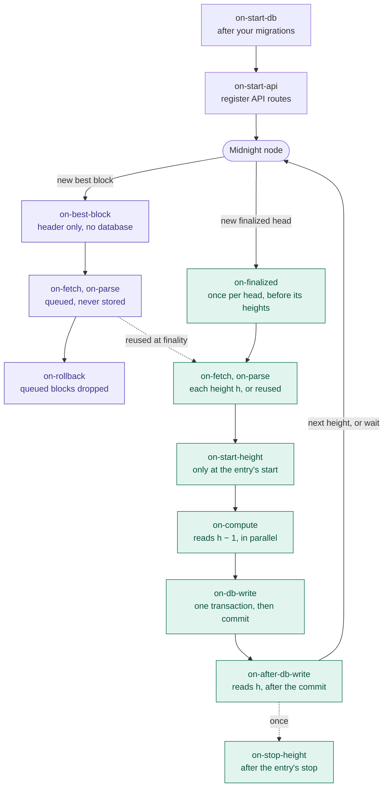

# UmbraDB node architecture

How an UmbraDB process reads the Midnight node and when each module callback (`on-*`) runs. The
[module guide](module-guide.md#3-callbacks-and-points) lists each point's arguments; this page is the order and the
reasons for it.

Purple: best blocks, worked on early and never stored. Green: finalized heights, the only path that writes.

## At each start

Before any block, the process runs every module's migrations, then `on-start-db` (with a schema write handle) and
`on-start-api` (with the API registry), in series. Then it reads the node: it subscribes to the finalized and the new
heads and reads the finalized head. A notified finalized block whose hash differs from one already read or stored halts
the process with `finality-conflict`.

## Best blocks: worked on early, never stored

Blocks above the finalized head can still change. For each new head the node announces:

- `on-best-block` runs with its header only (height, hash, parent hash); there is no database handle.
- The block is fetched, and `on-fetch` and `on-parse` run, so its items are ready if it becomes final.
- It joins the best-block queue: at most `tipCap` blocks (600 by default), and only while the finalized head is within
  `prefetchWindow` (64) of the cursor. A full queue sets the `finality-stall` condition.
- When the node switches to another fork, the queued blocks above the common ancestor are dropped with one
  `on-rollback`, lowest first, and the new branch is fetched.

`on-fetch` and `on-parse` may run more than once for a height, so they keep no state that outlives the block. Nothing
of a best block reaches the database.

## Finalized heights: one transaction each

For each new finalized head, `on-finalized` runs once, before the head's heights, with a read at the cursor. Then the
loop processes every height from the cursor + 1 to the head, one at a time:

1. **`on-fetch`, `on-parse`**: the block's items. A height the prefetch prepared (up to `prefetchWindow` heights ahead,
   eight at a time) or a queued best block with the finalized hash goes on with the items it already has; a queued
   block with another hash is dropped (`on-rollback`) and the finalized one fetched.
2. **`on-start-height`**: only at the height where a module's entry starts.
3. **`on-compute`**: reads the state at h − 1, outside any transaction; modules that do not depend on one another run
   at the same time. Compute here.
4. **`on-db-write`**: one `BEGIN … COMMIT` for every module's writes, the only point inside the block's transaction.
   Before the `COMMIT` the cursor is checked to be h with this block's hash.
5. **`on-after-db-write`**: reads the committed state at h. Notify subscribers here.
6. **`on-stop-height`**: once, after the height where a module's entry stops has committed.

After a height commits, the loop goes to h + 1. Once it reaches the finalized head it waits for the next one, with no
read or transaction open.

## When something fails

A failing callback ends its point: nothing after it runs and nothing of h is stored. The process halts at h − 1
(`halted`, with the module and point in `/status`'s `reason`), and a restart processes h again. A lost node or database
connection is not a failure: it is retried with back-off (`node-retrying`, `database-retrying`).

## Private processes

A private process runs the same finalized path without the node. Its `on-finalized` follows the public process's
commits, and its `on-fetch` reads a committed height from the public database. It has no best blocks.
